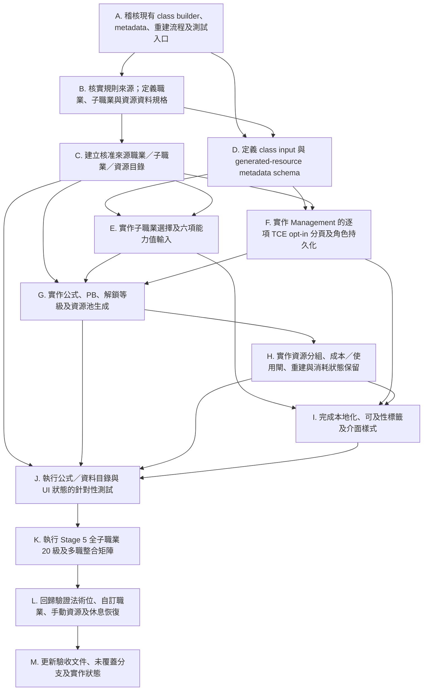

# D&D 5e 職業資源實作計劃

## 目標與範圍

擴充現有職業等級資源計算器，讓標準 2014 版 D&D 5e 職業輸入可選擇支援的子職業，並按職業等級、子職業、熟練加值及屬性調整值產生有限次數資源。現有法術位計算已實作，必須保持原有計算與行為。

第一階段集中處理明確按長休、短休恢復的資源，以及有每回合／每輪使用限制的資源。每回合或每輪限制屬使用頻率閘，不可當作短休或長休恢復池。七日、每日、事件觸發、付費再用及其他非標準恢復規則留待後續階段。

## 已確認範圍與規則決定

- **規則版本**：以 2014 版 D&D 5e 為準，不混用 2024 版。
- **來源優先次序及本輪範圍**：PHB 2014／DMG 2014、XGE、TCE、Fizban's Treasury of Dragons（FTD）、Bigby Presents: Glory of the Giants（BGG）、The Book of Many Things（BMT）；另作明確例外，加入 SCAG 的牧師 Arcana Domain。其他 SCAG 內容及其他未列來源暫不支援。
- **Artificer**：保留 Artificer 標準職業，採用核准來源中的 TCE 選項；不加入只見於 Eberron: Rising from the Last War 的子職業選項。
- **子職業選擇**：標準職業達到其 2014 規則實際的子職業特性解鎖等級時，必須選擇子職業。解鎖等級按職業而定，不統一設為 3 級。未到解鎖等級時毋須選擇。
- **自訂職業**：自訂職業不提供子職業選擇，繼續使用現有手動輸入方式。
- **能力值**：加入六項能力值輸入，以計算依賴能力調整值的資源上限；不得臆測未輸入的數值。
- **TCE 可選職業特性**：在 Management 新增獨立分頁，為每項支援的 TCE 可選職業特性提供各自獨立的開關；每個角色分別保存選擇，預設全部關閉。
- **BGG／BMT 專長及背景**：不加入職業輸入流程；相關資源留給手動輸入。
- **熟練加值**：依所有已啟用職業等級總和（角色總等級）計算。熟練加值不必在頁面顯示。
- **Bladesinger 版本**：採用 TCE 重印版本；不可與 SCAG 版本次數疊加。SCAG 的本輪唯一例外為牧師 Arcana Domain。
- **共用資源池**：多項職業或子職業能力共用同一池時，只建立一個底層資源池，例如 Ki、Rage、Channel Divinity、Bardic Inspiration、Sorcery Points 及 Superiority Dice。
- **異質資源**：可在同一資源卡片分組顯示，但各 inner pool 必須保留獨立識別、目前值、上限、恢復規則及資源成本；不得把不同冷卻或觸發條件合併成同一計數。
- **回合／回合輪次限制**：「每回合一次」、「自己回合內一次」及「每輪一次」須分別表示為使用限制，不可轉成休息恢復。一次性使用閘與有限恢復池可同時存在，需分開記錄。

## 現況與實作位置

- 職業輸入器及資源計算位於 `src/cr.js`，職業列動態插入 `cr.html` 的 `#classRows`。
- 標準職業預設及法術位進程已存在；自訂職業使用手動法術位進程。
- `readClassRows()` 會把職業設定存入產生資源的 metadata；套用確認流程會重建計算器產生的資源並保留手動資源。
- 一般非生命骰／法術位資源目前會廣泛分組顯示；新增職業資源時須在每個 inner pool 保留獨立識別及規則。
- 職業輸入介面的本地化檔案為 `src/locales/zh-HK.json` 及 `src/locales/zh-TW.json`。
- 專案沒有 `package.json` 或現成自動化測試 runner；瀏覽器驗收參考見 `.agent/CR/CR-stage5-playwright-tests.md`。
- 資源規則基線見 `.agent/CR/class-resource-recovery-reference.md`。

## 執行階段

### 階段 1：建立支援資料目錄

- 建立清晰、可稽核的職業／子職業資料目錄，標明來源與版本、子職業選擇解鎖等級、各有限次數特性的取得等級、最大值公式、恢復方式、額外成本及使用限制。
- 僅列入核准書籍中的標準子職業，另加入 SCAG 牧師 Arcana Domain；排除其他未核准來源、非標準選項及自訂職業。
- 在子職業資料目錄中標明 Arcana Domain 的 SCAG 來源，按 Cleric 1 級解鎖處理，並依資源參考盤點其有限次數資源；使用 Channel Divinity 的能力共用 Cleric 的 Channel Divinity 池，不重複建池。
- 先按職業等級特性表，盤點所有早於子職業選擇解鎖、但已有明確有限次數或恢復條件的職業資源。
- 對同一池的多個能力建立共用資源 key，不為每個能力重複建立次數。

### 階段 2：擴充職業輸入

- 在標準職業列加入子職業欄位；達到該職業實際解鎖等級後必須選擇，未達等級時隱藏或停用。
- 職業或等級更改時更新可選子職業及欄位狀態；語言切換、重新繪製和資源重套時保留選擇。
- 為能力調整值資源新增六項能力值輸入，並在欄位標籤和本地化說明中交代用途。
- 在 Management 新增「TCE 可選特性」分頁，逐項列出每個支援的 TCE optional class feature，使用各自獨立的 opt-in 開關；預設關閉，並按角色保存狀態。
- 更新職業或子職業輸入時，只有角色已啟用相應選項且符合該特性的職業／等級條件時，才納入資源計算；切換角色、重新開啟 Management、語言切換及重套資源時，正確載入並保留該角色的選項狀態。
- 自訂職業不顯示子職業欄位；既有自訂法術位行為維持不變。
- 將職業設定、子職業、能力值與各項可選特性選擇納入產生資源的 metadata，使重套資源時可還原完整輸入。

### 階段 3：產生第一批資源

- 先支援恢復規則明確的職業及子職業資源：長休、短休、短休或長休，以及有明確每回合／每輪使用閘的有限次數池。
- 職業資源及子職業資源均依角色輸入等級判斷是否取得；包括子職業選擇前已取得的職業特性。
- 按特性原文分別計算職業等級、角色總 PB、能力調整值及固定值上限；能力調整值的下限（例如至少 1）依規則資料明確記錄。
- 將法術位、Ki、Channel Divinity 等付款成本記作資源間消耗關係，不把「花既有池」誤建成額外免費次數池。
- 保持 SR/LR 同一池的語意；長休批次回復可涵蓋短休恢復資源。
- 暫不把每日、七日、1d4 次長休、擲先攻、事件觸發、資源交換或付費再用映射成一般短休／長休恢復。

### 階段 4：分組、重建與保留狀態

- 令職業／子職業資源可以按卡片分組，同時保留每個 inner pool 的唯一 key、current/max、恢復方式、使用閘及成本。
- 重套職業輸入時只替換計算器產生的職業資源；手動建立的資源必須保留。
- 對 key 相同且仍然存在的資源，保留現有消耗狀態；若上限變更，依既有資源管理 UX 呈現，不可靜默抹去超額狀態或將不同池合併。
- 現有生命骰與法術位分類、命名、分組及重建行為保持不變；不得改動法術位計算表或多職法術位算法。

### 階段 5：驗證與文件

- 兩種語言均補上新增職業欄位、子職業選項、錯誤訊息及說明文字。
- 以瀏覽器驗收至少涵蓋：
  - 各職業在實際解鎖等級前後顯示／要求子職業選擇。
  - Management 的 TCE 可選特性分頁逐項顯示獨立開關；啟用或停用一項不會改變其他選項。
  - TCE opt-in 預設關閉，並按角色持久化；切換角色、關閉／重開 Management、切換語言及重套資源後仍載入正確狀態。
  - 僅已啟用且符合職業／等級條件的 TCE 可選特性會影響資源生成；切換開關後資源套用結果相應更新。
  - 職業、等級、子職業、能力值及 TCE opt-in 的輸入與持久化。
  - PB、職業等級及能力調整值公式（含邊界值）。
  - 共用池不重複、不同恢復池分開、每回合／每輪限制獨立表示。
  - 重套時保留手動資源及相同資源池的消耗狀態。
  - 短休／長休恢復符合規則，特殊恢復未被錯誤映射。
  - 自訂職業不提供子職業，原有法術位與多職行為無回歸。
- 整合測試須使用以下角色矩陣：
  - **每個支援的子職業各一個 20 級角色案例**：逐一選取該子職業，驗證該職業及子職業截至 20 級取得的資源、上限公式、共用池及恢復設定。這是全子職業資料覆蓋，不可只挑代表性子職業；可用資料驅動測試逐筆產生案例。
  - **Fighter／Ranger／Rogue 多職**：驗證三職業同時啟用時的總等級 PB、各職業特性門檻、各自子職業選擇及資源不互相覆蓋。
  - **Sorcerer／Warlock 多職**：驗證兩種施法職業的職業資源、共享或相近資源不重複建池，並確認法術位既有行為不變。
  - **Bard／Paladin 多職**：驗證各自資源、依總等級計算的 PB，以及資源重套與恢復。
  - **Wizard／Artificer 多職**：驗證兩職的子職業及資源生成，並確認法術位及各職業進程維持正確。
  - **Cleric 1 級多職 dip**：搭配另一個較高等級職業，驗證 Cleric 在 1 級即須選子職業（包括適用的 Arcana Domain），且 Cleric 資源依 Cleric 職業等級而非角色總等級計算；PB 則依多職總等級計算。
- **覆蓋率建議**：上述案例是重要的整合情境，但單靠這些多職組合無法合理宣稱覆蓋 90% 的所有玩家用例；職業／子職業組合、取得等級、資源公式和恢復方式的排列仍很多。建議把「每個支援子職業的 20 級案例」作為子職業功能及資料的全覆蓋基線，再以每個不同資源公式、共享池、恢復規則、使用閘及輸入重建行為至少一個案例作規則矩陣覆蓋。若需要量化 90%，應先定義分母為受支援資源特性／規則分支，而非籠統的玩家用例；目標可設為至少 90% 的這些項目有自動化斷言，剩餘未覆蓋項目列明原因並以瀏覽器驗收補足。每一個多職案例另須驗證總 PB、職業等級歸屬及不重複建池。
- 完成 `.agent/CR/CR-class-resources-plan.md` 所列範圍後，更新計劃狀態及相關測試文件。

## 實作步驟 DAG 草案

下圖表示工作相依而非必須逐項串行的排程。各步驟以完成並通過其交付檢查為依賴解除條件；Cartomancer 與 Storm Strike 的原文核實只阻擋各自有疑問的資料項目，不阻擋其他明確資源。

### DAG 步驟交付與依賴

- **A → B**：先確認現有輸入、儲存、更新及測試邊界；再依 RAW 建立可追溯的資料規格。取得原文若受阻，只將對應規則項目標示待核實。
- **B → C**：資料目錄包含來源版本、解鎖等級、公式、共享池 key、恢復方式、成本及使用限制；未核實的特性不得以猜測值進入可執行目錄。
- **A、B → D**：metadata schema 須能持久化各職業輸入、能力值、每一項 TCE opt-in，以及資源 pool identity，並兼容既有手動資源。
- **C、D → E、F**：子職業與能力值 UI、TCE 獨立開關可平行實作，但兩者均須使用已定義的職業目錄及角色 metadata。TCE 開關預設關閉、互不連動，並按角色隔離。
- **C、E、F → G**：資源生成根據資料目錄和有效輸入計算；PB 使用總職業等級，其他公式使用其規則指定的職業等級／能力值。僅已啟用且符合條件的 TCE 選項參與計算。
- **G → H**：先產生正確的資源池，再處理卡片分組、不同 pool 保持獨立、恢復及重建時狀態保留。
- **E、F、H → I**：介面字串、可及性標籤與樣式需覆蓋新增控制及狀態，不自行改變計算規則。
- **C、G、H、I → J → K → L**：先驗證規則／UI 單元行為，再執行全子職業 20 級資料矩陣和指定多職案例，最後檢查既有行為無回歸。
- **L → M**：只有驗收結果、限制及未覆蓋規則分支均記錄後，才更新完成狀態與相關測試文件。

## 操作員需參與事項

### 必要：提供原書文字（若代理仍無法查閱原書）

實作前代理會先嘗試自行核對以下原書條文。只有在無法取得可靠原文時，才需要操作員提供相關頁面影像／逐字條文，或確認將該項目延後；毋須操作員代為整理或實作：

- **BMT Cartomancer（p. 49）**：確認卡牌施法是否明文免除法術位消耗。
- **BGG Storm Strike（p. 19）**：確認 PB 次／長休限制的確切適用範圍。

在這兩項條文核實前，代理不得把 Cartomancer 當作免費施法，也不得把 Storm Strike 的 PB 限制擴大至其他 Strike of the Giants 選項。若操作員不提供原文，代理會將有疑問的項目標為待處理並避免推測，不會因此阻擋其他已有明確規則的資源。

### 可選：完成後人工驗收

代理會自行執行可行的瀏覽器驗證並回報結果。若操作員希望確認實際遊戲流程，可再人工驗收子職業選擇、資源使用及休息恢復體驗；這不是代理開始實作前的必要前置條件。

### 代理負責、無須操作員代辦

- 依已核准的書籍範圍整理職業／子職業資料、資源公式及恢復規則。
- 按 RAW 盤點每項能力的解鎖等級、共享資源池、使用閘及額外成本。
- 修改程式、介面、本地化及相關文件；執行自動或瀏覽器測試並處理發現的回歸問題。
- 對規則上已明確且不涉及 house rule 的問題，先查核規則來源或諮詢 D&D 5E 規則審核代理；只有涉及 house rule 或產品範圍的新決定時才詢問操作員。

## RAW 核實事項

- **BMT Cartomancer（BMT p. 49）**：參考資料未確定卡牌施法是否免法術位。代理實作前先查核印刷條文；除非文字明確免除，按一般施法規則處理為需要支付合資格法術位，不可記成免費施法。若代理無法查閱原文，再按「操作員需參與事項」索取條文或延後該項目。
- **BGG Storm Strike（BGG p. 19）**：代理實作前先查核 PB 次／長休限制在印刷版中的適用範圍。未有明文支持時，只套用於 Storm Strike，不擴大至其他 Strike of the Giants 選項；其 PB 池與每回合使用閘分開表示。若代理無法查閱原文，再按「操作員需參與事項」索取條文或延後該項目。
- **核實原則**：D&D 規則審核代理在 Pass 1 無法存取原書；實作階段須重新嘗試查閱可靠原文，並在資源目錄保留核實依據，不可把代理先前無法查閱視為已核實。
- **其他非標準恢復**：例如 Divine Intervention 七日限制、擲先攻時補充及事件觸發恢復留待後續階段，第一階段不把它們當普通短休／長休池。

## 不可違反的實作限制

- 沿用 classic script、IIFE、現有本地化及事件處理模式；不引入框架、建置工具或第三方依賴。
- 不改動已實作的法術位計算邏輯。
- 不產生未核准來源或自訂職業的子職業資源；SCAG 僅允許 Cleric 的 Arcana Domain 作為例外。
- 不將專長／背景資源混入職業／子職業選擇範圍。
- 資源分組僅影響呈現，不得破壞 pool identity、恢復規則、觸發條件或成本。
